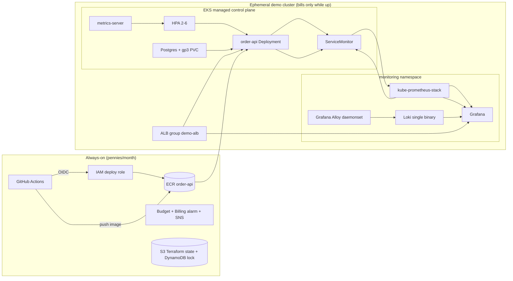

# AWS deployment (EKS, ephemeral demo cluster)

This repository additionally ships an AWS target architecture. The cluster is
**ephemeral by design**: EKS control plane, spot nodes and the ALB only bill
while `make aws-up` has not yet been followed by `make aws-down`, so a demo
budget of roughly **$8–10/month at 1–2 demo hours per day** is achievable.

## Architecture



Layered on top of the existing Compose/MicroK8s stack:

| Concern | Choice | Why it is worth showcasing |
|---|---|---|
| Compute | **EKS** managed control plane + **spot** managed node group (t3.medium/t3.large, 1-3 nodes) | Real Kubernetes at managed-service level, spot cost strategy |
| Networking | 2-AZ VPC, public/private subnets, **single NAT**, S3 gateway + ECR interface **VPC endpoints** | Proper subnet design; image pulls bypass NAT data charges |
| Load balancing | **AWS Load Balancer Controller** with one ALB shared by two Ingresses (`group.name: demo-alb`) | IRSA + controller-managed ALB, path-based routing to app and Grafana |
| State/BP | **IRSA** for EBS CSI and ALB controller | The modern pod-identity pattern, no long-lived credentials |
| Database | In-cluster Postgres on **gp3 PVC** (EBS CSI addon) | Fits the ephemeral budget; RDS is the documented production upgrade |
| Observability | kube-prometheus-stack (Prometheus + Grafana + Alertmanager), Loki + **Alloy** daemonset, metrics-server for the **HPA** | Same Grafana/Loki concepts as the Compose stack, cluster-native |
| CI/CD | GitHub Actions → OIDC → ECR (immutable tags, scan-on-push) → kubectl apply | Keyless deploy, no stored AWS keys |
| IaC | Terraform in two layers: `infra/bootstrap` (always-on) and `infra/cluster` (ephemeral) | Explicit lifecycle separation so state tooling never costs cluster money |
| Cost safety | AWS Budget + CloudWatch billing alarm + SNS email | Guardrails before any cluster is created |

## Cost model

| Resource | Rate | ~2h/day demo (20 days) |
|---|---|---|
| EKS control plane | $0.10/h | ~$4 |
| 2x t3.medium spot nodes | ~$0.025/h | ~$1 |
| ALB | ~$0.025/h + LCU | ~$1 |
| NAT gateway | ~$0.045/h | ~$2 |
| EBS volumes (nodes + PVCs) | ~$0.10/GB-month | ~$1 |
| Always-on (S3 state, DynamoDB lock, ECR, alarms) | | <$1 |
| **Total** | | **~$9-10/month** |

Never leave the cluster up over night: `make aws-down` when the demo ends.

## One-time setup

```bash
terraform --version          # >= 1.9
aws sts get-caller-identity  # credentials configured

make aws-bootstrap EMAIL=you@example.com REPO=your_org/your_repo
# -> creates S3 state bucket, DynamoDB lock, ECR repo, budget + billing alarm,
#    and a GitHub OIDC deploy role. Confirm the SNS subscription email.
```

Then add two GitHub repo secrets (names come from the bootstrap output):

- `AWS_DEPLOY_ROLE_ARN` – `github_deploy_role_arn` output
- `AWS_CLUSTER_NAME` – `fastapi-pool-mvp-demo`

## Daily demo loop

```bash
make aws-up           # ~12-15 min: VPC, EKS, spot nodes, Helm stack; writes .env.aws
make aws-deploy       # build + push ECR, render manifests, deploy app + ingresses
#   API:     http://<ALB_HOSTNAME>/health
#   Grafana: http://<ALB_HOSTNAME>/grafana  (creds in infra/cluster variables.tf)
make aws-down         # terraform destroy; stops all hourly billing
```

Optional automation: `.github/workflows/deploy.yml` (manual dispatch) builds,
pushes and deploys without local tooling when the cluster is running.

## Notes

- Kubernetes version default is `1.35` (`infra/cluster/variables.tf`). EKS
  bills **6x** once a version enters extended support, so bump it before the
  14-month standard-support window lapses.
- Helm chart versions are pinned in `infra/cluster/variables.tf`. If a chart
  version is no longer published, run `helm search repo <chart>` and bump.
- Grafana admin password default is a demo value; override
  `grafana_admin_password` in production-like runs.
- In-cluster Postgres is destroyed with the cluster (including its PVC).
  Production upgrade path: RDS instance + `DB_HOST` change, everything else
  (pool instrumentation, ServiceMonitor) stays identical.
- `admin_cidrs` defaults to `0.0.0.0/0` for the public API endpoint; restrict
  it to your IP for tighter demos (`-var="admin_cidrs=[\"1.2.3.4/32\"]"`).
