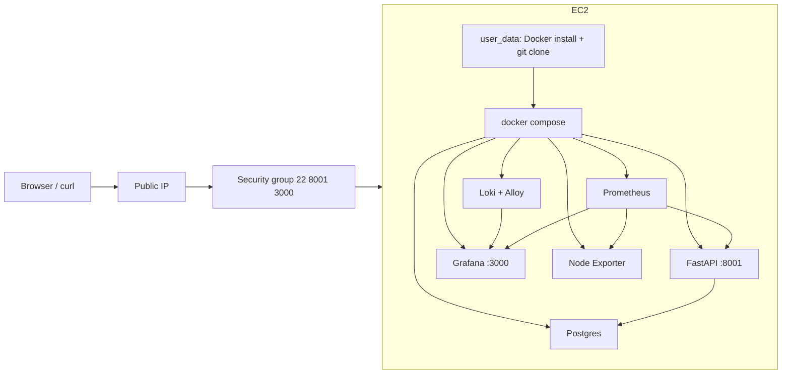

# AWS EC2 demo (simple cloud VM instead of local Ubuntu)

The sandbox account (member of a training AWS Organization) denies
EKS/ECS/IAM/ECR via Service Control Policies **for IAM users, but allows EC2
for the `AccountFullAccessRole`** — the identity AWS CloudShell runs as. So
the automation below runs from **CloudShell** (or any shell with that role's
session). Everything is Terraform-managed with local state.

## Architecture



Same stack as the local Compose setup, one cloud VM, zero IAM dependencies.

## Cost

Your builder account has ~$165 credits. `t3.small` (~$0.021/h + ~$1.5/mo gp3
20GB + public IPv4) is **~$16/mo running 24/7 — credits cover ~10 months**.
Use `make ec2-stop` between demos to make credits last effectively forever.

## One-time: install Terraform in CloudShell

```bash
curl -sLo /tmp/tf.zip https://releases.hashicorp.com/terraform/1.9.8/terraform_1.9.8_linux_amd64.zip
cd /tmp && unzip -o tf.zip && mkdir -p ~/bin && install terraform ~/bin/
echo 'export PATH=$HOME/bin:$PATH' >> ~/.bashrc && source ~/.bashrc
```

## One-time: get the repo into CloudShell

The repo must be publicly readable for `git clone` (or upload a zip via the
CloudShell Files menu):

```bash
git clone https://github.com/Shahriarin2garden/fastapi-pool-mvp-observability.git
cd fastapi-pool-mvp-observability
```

## Daily loop (from CloudShell, inside the repo)

```bash
make ec2-up      # ~5-8 min: instance + Docker + compose up, then waits for /health
make ec2-stop    # between demos: billing stops, disk persists
make ec2-resume  # same stack back, new public IP printed
make ec2-destroy # full teardown
```

`ec2-up` also writes `fastapi-pool-mvp-demo-key.pem` (SSH key) and
`.ec2-grafana-password` into the repo directory in CloudShell.

## Demo URLs

- API: `http://<public-ip>:8001/health`
- Grafana: `http://<public-ip>:3000` (user `admin`, password from
  `.ec2-grafana-password` or `terraform -chdir=infra/ec2 output -raw grafana_admin_password`)

## Notes

- Public IP **changes** after every stop/resume — the scripts print the new one.
- SSH is open to `0.0.0.0/0` by default (`infra/ec2/variables.tf`); restrict
  `ssh_cidr`/`web_cidr` to your IP for tighter demos.
- `t3.micro` would be free-tier eligible but 1 GiB is too tight for six
  containers; `t3.small` is the deliberate choice.
- The EC2 layer lives in `infra/ec2/` with **local state** in CloudShell's
  persistent home directory — no S3/DynamoDB (denied by the SCP anyway).
- The EKS architecture (infra/cluster, AWS_DEPLOY.md) stays in the repo for a
  future unrestricted account; `infra/bootstrap` resources (budget) remain.
