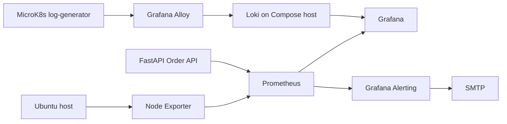

# System & Application Observability

**Candidate:** `CANDIDATE_NAME`
**Candidate ID:** `CANDIDATE_ID`

This repository demonstrates real host and application metrics, Kubernetes pod
logs, and controlled Grafana email alerting. It retains the original FastAPI
`/users` API and database-pool instrumentation.

## Ubuntu quick path

```bash
git clone <NEW_REPOSITORY_URL>
cd fastapi-pool-mvp-observability
scripts/bootstrap-ubuntu.sh
scripts/bootstrap-ubuntu.sh --yes
cp .env.example .env
# edit .env, including NODE_EXPORTER_BIND, LOKI_BIND_IP, SMTP_* and ALERT_RECIPIENT
make preflight
make up
make verify
make k8s-up
make traffic
make alert-test
make evidence
make zip
```

The first bootstrap command is a dry run. The `--yes` form performs installation
and may require a new login for group membership. Use a Gmail App Password, not
your normal account password.

## Architecture



Docker Compose runs PostgreSQL, the API, Prometheus, Node Exporter, Loki, and
Grafana. MicroK8s is a separate local cluster: Alloy reads pod logs and pushes
them to Loki on the Ubuntu host. Prometheus evaluates real changing metrics;
Grafana sends alert email through the configured SMTP server.

## AWS deployments

The repository ships three AWS targets, all sharing the same Compose stack
and observability concepts as the local setup:

**Lightsail demo (works in the restricted sandbox account).** The sandbox org
SCP denies EC2/EKS/ECS/IAM/ECR mutations, but Lightsail is not on the deny
list, so this path runs from CloudShell: a bundled Ubuntu 24.04 VM
(2 vCPU/2 GiB, ~$10/mo) is created with cloud-init that installs Docker,
clones the repo and starts the full Compose stack with public bindings for
the API (`:8001`) and Grafana (`:3000`). See
[AWS_LIGHTSAIL.md](AWS_LIGHTSAIL.md):

```bash
make lightsail-up      # create + bootstrap + wait for /health
make lightsail-stop    # pause compute billing between demos
make lightsail-resume  # bring it back (public IP is printed)
make lightsail-destroy # full teardown
```

**EC2 demo (unrestricted accounts).** Terraform-managed t3.small with
cloud-init bootstrap (`infra/ec2/`, local state) — see
[AWS_EC2.md](AWS_EC2.md):

```bash
make ec2-up && make ec2-stop && make ec2-resume && make ec2-destroy
```

**EKS reference architecture (unrestricted accounts).** A full
production-shaped design: Terraform layers in `infra/bootstrap/` (S3 state,
ECR, budget + billing alarm, GitHub OIDC deploy role) and `infra/cluster/`
(2-AZ VPC with NAT and ECR VPC endpoints, EKS with spot managed nodes, IRSA
for EBS CSI and the ALB controller, Helm-managed kube-prometheus-stack, Loki,
Alloy, metrics-server), plus ALB ingresses, HPA and ServiceMonitor manifests
in `kubernetes/aws/`. The cluster is ephemeral by design (~$9/month at 1-2
demo hours per day). See [AWS_DEPLOY.md](AWS_DEPLOY.md):

```bash
make aws-bootstrap EMAIL=you@example.com   # once: state bucket, ECR, budget
make aws-up && make aws-deploy && make aws-down
```

## Repository structure

`app/` contains the API and existing user feature; `migrations/` contains the
database schema; `prometheus/`, `loki/`, and `grafana/` contain observability
configuration; `kubernetes/` contains the MicroK8s workload and Alloy values;
`scripts/` contains reproducible traffic, verification, and evidence commands.
Old helpers remain in `scripts/legacy/`.

## Prerequisites

Ubuntu with Docker Engine and the Compose plugin is required. MicroK8s and its
Helm plugin are needed only for the Kubernetes log flow:

```bash
docker --version
docker compose version
sudo snap install microk8s --classic
microk8s status --wait-ready
```

Images are pinned to PostgreSQL 15, Prometheus 2.55.1, Grafana 11.4.0, Loki
3.4.2, Node Exporter 1.8.2, and BusyBox 1.36.

## Configuration and quick start

```bash
cp .env.example .env
# edit .env; use a Gmail App Password if using Gmail
docker compose up -d --build
```

Open Grafana at <http://127.0.0.1:3000>, Prometheus at
<http://127.0.0.1:9090>, and API docs at <http://127.0.0.1:8001/docs>.
Credentials come only from `.env`. `DB_PASS`, Grafana credentials, SMTP values,
and the recipient are never committed.

Important variables are `DB_*`, pool sizes and `COMMAND_TIMEOUT`, `FAILURE_RATE`
(0..1 simulated failure probability), `GF_ADMIN_*`, `NODE_EXPORTER_BIND`,
`LOKI_BIND_IP`, and `SMTP_*` plus `ALERT_RECIPIENT`. See `.env.example` for the
complete list.

## Networking and security

All local services bind to loopback. PostgreSQL is not published. Node Exporter
uses host networking and defaults to `172.17.0.1:9100`; Loki uses
`LOKI_BIND_IP:3100` so MicroK8s can reach it. If a LAN address is required,
restrict it with `sudo ufw allow from 10.1.0.0/16 to any port 3100` and deny
other access. Verify with `ss -tlnp | grep -E '9100|3100'`. Never put SMTP
credentials in screenshots or logs.

## Kubernetes logging

Follow [kubernetes/README.md](kubernetes/README.md) to deploy the deterministic
BusyBox workload, render the Alloy host address, install the Grafana Alloy
chart, and query `{namespace="demo"}` or `{namespace="demo"} |= "ERROR"` in
Grafana Explore.

## Metrics and dashboards

The API exposes `orders_created_total{status}`, `order_requests_total{status_class}`,
`order_request_duration_seconds`, and `order_value_cents_total`, while retaining
all `db_*` metrics and default HTTP instrumentation. The generated metrics
dashboard includes host CPU/RAM/disk/network/uptime, request rate and errors,
p95 latency, business events, target health, and DB pool/query panels. Run
`make dashboards` after changing [scripts/generate_dashboards.py](scripts/generate_dashboards.py).

Use `bash scripts/crosscheck.sh` to compare `free`, `df`, and `uptime` with
Prometheus queries. Use `bash scripts/traffic-test.sh normal|burst|failure|all`
to create real successful, high-rate, and controlled-failure traffic.

## Alerting

Grafana provisions `OrderAPIDown` (critical, one-minute pending) and
`HighOrderFailureRate` (warning, 20% for two minutes) from
[grafana/provisioning/alerting](grafana/provisioning/alerting). See
[alerting/configuration-notes.md](alerting/configuration-notes.md). For a safe
test, run `docker compose stop app`, wait two minutes, verify the alert/email,
then run `docker compose start app`.

## Testing and verification

```bash
pytest
bash scripts/verify.sh
make traffic
make evidence
```

The original live tests expect the Compose network (`http://app:8000`). Run
them after the stack is healthy. `scripts/verify.sh` reports WARN rather than
FAIL when the optional Kubernetes log stream is not installed.

## CI

GitHub Actions runs repository linting, shellcheck, isolated tests, Compose and
Prometheus/Loki configuration validation, and a Docker stack smoke test. CI
cannot validate MicroK8s networking, firewall rules, or real SMTP delivery.

## What was verified vs. the Ubuntu laptop

| Check | Local Windows | Ubuntu/CI |
|---|---|---|
| Python compilation and dashboard generation | Verified | Repeated in CI |
| Compose interpolation and repository lint | Verified where Docker-independent | Docker-backed checks in CI |
| API tests | Requires installed dependencies | Isolated tests in CI |
| MicroK8s, firewall, SMTP, email | Not run | Requires the human Ubuntu setup |

## Live demo and persistence

Run normal traffic, a burst, and failures; observe request rate, p95, failure
rate, and orders in Grafana. Trigger `scripts/k8s-error-burst.sh` and search
Loki. Stop the app to fire `OrderAPIDown`, observe the email, then restore it.
The single-node filesystem Loki, static scrape targets, and unauthenticated
local endpoints are deliberate assessment limitations.

`docker compose down` preserves named volumes. Start again and confirm database
rows, metrics history, and dashboards remain. Destructive cleanup is
`docker compose down -v`; remove MicroK8s with `sudo snap remove microk8s` only
when no longer needed.

## Evidence and submission

The required screenshot names and views are listed in
[evidence/README.md](evidence/README.md). Run `bash scripts/make-zip.sh
CANDIDATE_ID` only after committing; it uses `git archive`, so `.env` cannot
enter the archive.

## Manual steps and troubleshooting

[MANUAL_STEPS.md](MANUAL_STEPS.md) lists actions that require the human:
installing Ubuntu tooling, filling secrets, firewall configuration, deploying
MicroK8s/Alloy, SMTP verification, and screenshots. If Alloy cannot push logs,
check the rendered host IP, firewall, Loki `/ready`, and Alloy logs. If a
target is down, inspect `docker compose ps`, app logs, database health, and the
Prometheus targets page.

| Symptom | Likely cause | Fix |
|---|---|---|
| Node Exporter DOWN | Host bind address is wrong | Set `NODE_EXPORTER_BIND` to the Docker bridge address and inspect `ss -tlnp` |
| Prometheus cannot resolve `host.docker.internal` | Missing host gateway mapping | Keep `extra_hosts` and restart Compose |
| Alloy cannot reach Loki | Loopback or firewall | Set `LOKI_BIND_IP` to the laptop IP and allow only the pod CIDR |
| No Loki logs | Alloy RBAC, labels, or workload | Inspect Alloy logs and `kubectl logs`; confirm `{namespace="demo"}` |
| Grafana provisioning error | Alert YAML schema or environment | Inspect Grafana logs; use the documented UI export fallback |
| No email | SMTP auth/App Password, port 587, or spam | Check SMTP settings, credentials, firewall, and spam folder |
| Docker socket permission denied | User lacks docker group | Log in again after bootstrap, then run `id -nG` |
| MicroK8s group error | Session has stale groups | Run `newgrp microk8s` or log in again |
| Empty dashboards | No traffic or short time range | Run `make traffic` and widen the dashboard time range |
| Port already in use | Another service owns a published port | Run `make preflight`, stop the conflicting service, or change local bindings |

## Assessment checklist

### Ubuntu 26.04 setup

On Ubuntu 26.04, install Docker Engine with the Compose plugin, MicroK8s,
`kubectl`, and Helm. The bootstrap helper installs the required host tools;
verify them with:

```bash
docker --version
docker compose version
microk8s status --wait-ready
microk8s kubectl version --client
microk8s helm3 version
```

The reproducible path is:

```bash
make preflight
make up
make verify
make k8s-up
make traffic
```

### Verification and persistence

`make verify` must report healthy Compose services, reachable Prometheus and
Grafana endpoints, and the expected metrics. `make k8s-up` must report the
MicroK8s workload and Alloy as ready; `make traffic` changes request, latency,
order, and failure panels. To verify persistence, run:

```bash
docker compose down
docker compose up -d
make verify
```

The database rows, named-volume data, provisioned dashboards, and retained
Prometheus/Loki data remain available after this restart. Use `make down` and
`make k8s-down` for normal cleanup; use `make clean CONFIRM=yes` to remove
Compose volumes, and remove MicroK8s only when it is no longer needed.

### PromQL reference

| Signal | Expression | Explanation |
|---|---|---|
| CPU | `100 - avg(rate(node_cpu_seconds_total{mode="idle"}[1m])) * 100` | Converts idle CPU time into host CPU utilisation percentage. |
| RAM | `(1 - node_memory_MemAvailable_bytes / node_memory_MemTotal_bytes) * 100` | Shows the percentage of host memory currently unavailable. |
| Requests/second | `sum(rate(order_requests_total[1m]))` | Counts the API request rate over the last minute. |
| Error/failure rate | `100 * sum(rate(order_requests_total{status_class="5xx"}[1m])) / clamp_min(sum(rate(order_requests_total[1m])), 1e-9)` | Divides failed order requests by all requests without a zero denominator. |
| p95 latency | `histogram_quantile(0.95, sum by (le) (rate(order_request_duration_seconds_bucket[1m])))` | Estimates the 95th-percentile order request latency. |

### Host cross-checks

Compare dashboard values with the Ubuntu host commands `free -h`, `df -h`,
and `uptime`. Record the same observation window in the table:

| Measurement | Grafana/Prometheus | Host command | Real value |
|---|---|---|---|
| RAM used | RAM panel | `free -h` | __________ |
| Root disk used | Disk panel | `df -h /` | __________ |
| Host uptime | Uptime panel | `uptime` | __________ |

### MicroK8s logs to Loki

Alloy discovers MicroK8s pods through the Kubernetes API and reads their
container log files using its Kubernetes source. It pushes to the Compose-host
Loki HTTP endpoint:
`http://<LAPTOP_IP>:3100/loki/api/v1/push`.
`scripts/render-alloy-values.sh` substitutes `<LAPTOP_IP>` into
`kubernetes/.rendered/alloy-values.yaml`; `LOKI_BIND_IP` must expose that
address, restricted by the firewall to the MicroK8s pod CIDR. Test the route
from inside a pod with:

```bash
microk8s kubectl run curltest --rm -it --restart=Never \
  --image=curlimages/curl -- curl -s http://<LAPTOP_IP>:3100/ready
```

### Demonstration

Run `scripts/traffic-test.sh normal` for successful requests,
`scripts/traffic-test.sh burst` for a higher traffic rate, and
`scripts/traffic-test.sh failure` for controlled HTTP 500 failures. Normal
traffic increases `orders_created_total`; burst traffic increases request rate
and p95 latency; failures increase the 5xx failure-rate panel and produce
corresponding application logs. Run `scripts/k8s-error-burst.sh` to add
timestamped Kubernetes errors visible through the Loki dashboard and Explore.

### Security and limitations

Observability ports are bound to `127.0.0.1` by default; Loki is the intentional
exception when `LOKI_BIND_IP` is set to the laptop address for MicroK8s.
Secrets are not stored in Git, and SMTP is configured only through `.env`.
The single-node filesystem storage and static scrape targets are deliberate
assessment limitations; production use should add durable storage, TLS/auth,
and dynamic service discovery.

### Candidate information

```text
Name: CANDIDATE_NAME
ID: CANDIDATE_ID
GitHub: https://github.com/CANDIDATE_USERNAME/CANDIDATE_REPOSITORY
```

## License

See [LICENSE](LICENSE).
