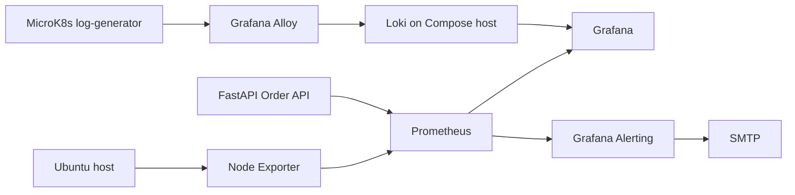

# System & application observability

**Candidate:** `CANDIDATE_NAME`
**Candidate ID:** `CANDIDATE_ID`

This repository demonstrates real Ubuntu host and FastAPI Order API metrics in
Prometheus and Grafana, MicroK8s pod logs collected by Grafana Alloy into Loki,
and a Grafana alert delivered over SMTP. The demonstrated deployment is Ubuntu
24.04 on AWS Lightsail, with MicroK8s v1.35 and Docker Compose on the same host.

**Status:** Metrics, Kubernetes logs, Grafana Explore searches, and the SMTP
alert email were demonstrated on 11 Nov 2026 on the Lightsail deployment.

## Table of contents

- [Architecture](#architecture)
- [Repository structure](#repository-structure)
- [Prerequisites](#prerequisites)
- [Quick start](#quick-start)
- [Configuration](#configuration)
- [Verify metrics](#verify-metrics)
- [Order API and metrics](#order-api-and-metrics)
- [Order Console](#order-console)
- [Kubernetes logs](#kubernetes-logs)
- [Grafana dashboards](#grafana-dashboards)
- [Email alerting](#email-alerting)
- [Persistence test and cleanup](#persistence-test-and-cleanup)
- [Deviations from the reference brief](#deviations-from-the-reference-brief)
- [Security notes](#security-notes)
- [Evidence checklist](#evidence-checklist)
- [Troubleshooting](#troubleshooting)
- [Known limitations](#known-limitations)
- [AWS deployment targets](#aws-deployment-targets)
- [License](#license)

## Architecture



| Component | Version | Port | Bind address | Purpose |
|---|---|---:|---|---|
| PostgreSQL | 15 | unpublished | Compose network | Order data |
| FastAPI Order API | repository build | 8001 | `127.0.0.1` locally, all interfaces with `compose.ec2.yaml` | API and `/metrics` |
| Prometheus | 2.55.1 | 9090 | `127.0.0.1` | Scrapes host and API metrics |
| Node Exporter | 1.8.2 | 9100 | host network, `NODE_EXPORTER_BIND` | Ubuntu host metrics |
| Loki | 3.4.2 | 3100 | `LOKI_BIND_IP` | Receives Kubernetes logs |
| Grafana | 11.4.0 | 3000 | `127.0.0.1` locally, all interfaces with `compose.ec2.yaml` | Dashboards, Explore, alerting |
| MicroK8s workload | BusyBox 1.36 | none | cluster network | Generates real pod logs |
| Grafana Alloy | Helm chart | none | cluster network | Discovers and ships pod logs |

The base Compose file publishes the API, Prometheus, and Grafana on loopback.
The EC2 override publishes the API and Grafana on all interfaces. The observed
Lightsail deployment uses that override. Loki binds to `LOKI_BIND_IP`, and
PostgreSQL is never published.

## Repository structure

- `app/`: FastAPI application, order routes, database access, and metrics.
- `prometheus/`, `loki/`, `grafana/`: monitoring configuration and dashboards.
- `kubernetes/`: MicroK8s namespace, workload, and Alloy values.
- `frontend/`: Vite, React, TypeScript Order Console.
- `scripts/`: bootstrap, verification, traffic, evidence, and deployment tools.
- `evidence/`: evidence naming guide and collected text output.
- `infra/`: EC2 and EKS Terraform configuration.

## Prerequisites

Use Ubuntu 24.04 with Docker Engine and the Docker Compose plugin. The
Kubernetes flow also needs MicroK8s and Helm through `microk8s helm3`.

```bash
docker --version
docker compose version
sudo snap install microk8s --classic
sudo usermod -aG microk8s,docker "$USER"
newgrp microk8s
microk8s status --wait-ready
microk8s enable dns helm3
microk8s helm3 version
```

On a 2 GiB host, Compose plus MicroK8s needs about 2 GiB of swap. If swap is
not already available, create it before installing addons:

```bash
sudo fallocate -l 2G /swapfile
sudo chmod 600 /swapfile
sudo mkswap /swapfile
sudo swapon /swapfile
echo '/swapfile none swap sw 0 0' | sudo tee -a /etc/fstab
```

## Quick start

Run this sequence from a clean Ubuntu machine. `bootstrap-ubuntu.sh` first
prints its commands; the `--yes` form installs Docker, MicroK8s, and addons.

```bash
git clone <NEW_REPOSITORY_URL>
cd <REPOSITORY_DIRECTORY>
scripts/bootstrap-ubuntu.sh
scripts/bootstrap-ubuntu.sh --yes
cp .env.example .env
# Edit .env, including NODE_EXPORTER_BIND, LOKI_BIND_IP, SMTP_* and ALERT_RECIPIENT.
make preflight
make up
make verify
```

If `.env` is root-owned, prefix Compose commands with `sudo`, for example
`sudo docker compose ps`. Open the locally bound services through an SSH
tunnel or use the public bindings described in [AWS deployment targets](#aws-deployment-targets).

The Docker image builds the frontend in a Node 20 stage and serves its output
from the FastAPI image. For local frontend work, use:

```bash
cd frontend
npm ci
npm run build
```

The build was validated locally before the image change. The 2 GiB Lightsail
host should build the image only with sufficient swap, or receive an image
built in CI or on a workstation.

Deploy the Kubernetes log flow:

```bash
make k8s-up
microk8s kubectl -n demo get pods
microk8s kubectl -n monitoring get pods
```

Generate metrics and logs, test the alert, and collect evidence:

```bash
make traffic
scripts/k8s-error-burst.sh
make alert-test
make evidence
make zip
```

`make zip` runs `scripts/make-zip.sh CANDIDATE_ID` with the literal placeholder.
For a candidate-named archive, run `scripts/make-zip.sh CANDIDATE_ID` directly
after replacing that argument with the actual ID. The archive is created from
the latest commit, so commit the intended files first.

## Configuration

The Compose files and Grafana provisioning use these `.env` variables. Values
below are placeholders only.

| Variable | Purpose | Example placeholder | Required |
|---|---|---|---|
| `DB_HOST` | Database host in the example environment | `db` | Yes for local app configuration |
| `DB_PORT` | Database port | `5432` | Yes |
| `DB_USER` | Database user | `postgres` | Yes |
| `DB_PASS` | Database password | `change-me` | Yes, replace |
| `DB_NAME` | Database name | `fastdb` | Yes |
| `POOL_MIN_SIZE` | Minimum async pool size | `2` | Yes |
| `POOL_MAX_SIZE` | Maximum async pool size | `10` | Yes |
| `COMMAND_TIMEOUT` | Database command timeout | `5` | Yes |
| `FAILURE_RATE` | Simulated failure probability from 0 to 1 | `0` | Yes |
| `GF_ADMIN_USER` | Grafana administrator username | `admin` | Yes |
| `GF_ADMIN_PASSWORD` | Grafana administrator password | `change-me` | Yes, replace |
| `NODE_EXPORTER_BIND` | Host address for Node Exporter | `<DOCKER_BRIDGE_IP>` | Yes |
| `LOKI_BIND_IP` | Host address reachable by MicroK8s | `<HOST_PRIVATE_IP>` | Yes for Kubernetes logs |
| `SMTP_HOST` | SMTP server and port | `smtp.example.test:587` | Yes for email |
| `SMTP_USER` | SMTP username | `<SMTP_USER>` | Yes for email |
| `SMTP_PASSWORD` | SMTP password or app password | `<SMTP_PASSWORD>` | Yes for email |
| `SMTP_FROM_ADDRESS` | Sender address | `<ALERT_SENDER>` | Yes for email |
| `ALERT_RECIPIENT` | Alert recipient | `<ALERT_RECIPIENT>` | Yes for email |

Set `LOKI_BIND_IP` to the host private IP that MicroK8s pods can route to.
Never set it to `0.0.0.0`. Keep port 3100 closed in any cloud firewall and
allow it only from the required cluster traffic. `BASE_URL`, `DURATION`, and
`RATE` are optional environment overrides read by `scripts/traffic-test.sh`;
they are not Compose variables.

## Verify metrics

`make verify` checks Compose services, the API health and metrics endpoints,
Prometheus health and targets, Grafana health, and Loki readiness. Confirm both
`node-exporter` and `order-api` are UP at:

```text
http://<PROMETHEUS_HOST>:9090/targets
```

Use these five PromQL expressions in Prometheus or Grafana:

| Signal | Expression | Explanation |
|---|---|---|
| CPU | `100 - avg(rate(node_cpu_seconds_total{mode="idle"}[1m])) * 100` | Converts idle CPU time into host CPU utilisation percentage. |
| RAM | `(1 - node_memory_MemAvailable_bytes / node_memory_MemTotal_bytes) * 100` | Shows the percentage of host memory currently unavailable. |
| Requests/second | `sum(rate(order_requests_total[1m]))` | Counts API request rate over the last minute. |
| Error/failure rate | `100 * sum(rate(order_requests_total{status_class="5xx"}[1m])) / clamp_min(sum(rate(order_requests_total[1m])), 1e-9)` | Divides failed order requests by all requests without a zero denominator. |
| p95 latency | `histogram_quantile(0.95, sum by (le) (rate(order_request_duration_seconds_bucket[1m])))` | Estimates the 95th-percentile order request latency. |

Run the host cross-check and compare its output with the same Grafana time
window. Recorded values belong in the evidence files, not in this README:

```bash
scripts/crosscheck.sh
```

The script compares `free`, `df`, and `uptime` with Prometheus RAM, disk, and
uptime queries. The evidence collection command writes a timestamped text file
under `evidence/`.

## Order API and metrics

The API is available at `/health`, `/docs`, `/api/orders`, and `/metrics`.
Order instrumentation includes:

- `orders_created_total{status}`
- `order_requests_total{status_class}`
- `order_request_duration_seconds`
- `order_value_cents_total`

The application also retains database-pool and default HTTP metrics. Traffic
can be generated in three modes:

```bash
scripts/traffic-test.sh normal
scripts/traffic-test.sh burst
scripts/traffic-test.sh failure
```

`normal` creates five successful orders. `burst` sends concurrent traffic for
`DURATION` seconds at `RATE` requests per second. `failure` sends simulated
HTTP 500 requests and one invalid order. `all` runs all three modes:

```bash
scripts/traffic-test.sh all
```

## Order Console

Open the FastAPI root URL to use the Order Console. It places real orders,
shows session orders and client latency, and emits telemetry to
`POST /api/telemetry`. The form mirrors the API constraints exactly. The load
drills use the same `simulate_failure=true` mechanism as
`scripts/traffic-test.sh`, so failed requests appear in the API metrics.

The console sends allowlisted events, web vitals, client API latency, and
JavaScript errors. The backend validates event names and labels, limits batches
to 50 events and 8 KB, applies a per-IP in-memory rate limit, and never stores
request bodies. Events are pushed asynchronously to Loki with labels
`app="order-ui"`, `job="frontend"`, and `level`; a Loki outage does not block
orders and increments `frontend_log_push_failures_total`.

Each API request includes a W3C `traceparent` header. The API reads the trace
ID and returns it in `X-Trace-Id`; the console displays that ID and can link it
to a configured `VITE_TEMPO_BASE`. Real Tempo spans are phase 2 and are not
part of this implementation.

Optional frontend build variables are documented in
[frontend/.env.example](frontend/.env.example):

```bash
VITE_GRAFANA_URL=<GRAFANA_URL>
VITE_TEMPO_BASE=<TEMPO_TRACE_URL>
```

The generated metrics dashboard includes frontend LCP and INP p75, UI order
outcomes, frontend JavaScript errors, and client/server latency panels. Run
`make dashboards` after changing
[scripts/generate_dashboards.py](scripts/generate_dashboards.py).

## Kubernetes logs

The detailed manifest notes are in [kubernetes/README.md](kubernetes/README.md).
Install MicroK8s, enable DNS and Helm, and apply the `demo` workload:

```bash
sudo snap install microk8s --classic
sudo usermod -aG microk8s "$USER"
newgrp microk8s
microk8s status --wait-ready
microk8s enable dns helm3
microk8s kubectl apply -f kubernetes/namespace.yaml -f kubernetes/workload.yaml
microk8s kubectl -n demo logs deploy/log-generator --tail=20
```

Test in-cluster reachability before installing Alloy:

```bash
microk8s kubectl run curltest --rm -it --restart=Never \
  --image=curlimages/curl -- \
  curl -s http://<HOST_PRIVATE_IP>:3100/ready
```

Render the actual Alloy URL and install the chart:

```bash
scripts/render-alloy-values.sh <HOST_PRIVATE_IP>
microk8s helm3 repo add grafana https://grafana.github.io/helm-charts
microk8s helm3 repo update
microk8s helm3 upgrade --install alloy grafana/alloy -n monitoring \
  --create-namespace -f kubernetes/.rendered/alloy-values.yaml
microk8s kubectl -n monitoring get pods
```

The renderer substitutes `__LOKI_HOST__` in
`kubernetes/alloy-values.yaml` and writes `kubernetes/.rendered/alloy-values.yaml`.
That rendered directory is gitignored. `make k8s-up` performs the apply,
render, install, readiness wait, and reachability test in one sequence.

In Grafana Explore, verify labels `namespace`, `pod`, `container`, `app`, and
`cluster=microk8s`, then run:

```text
{namespace="demo"}
{namespace="demo"} |= "ERROR"
{app="log-generator"} | logfmt | level="WARN"
```

Generate additional deterministic errors with:

```bash
scripts/k8s-error-burst.sh
```

## Grafana dashboards

Grafana is provisioned with Prometheus and Loki data sources, dashboards from
`grafana/dashboards/`, and alerting files from
`grafana/provisioning/`. The dashboard list includes `observability-metrics`
and `kubernetes-logs`.

Generate the dashboard JSON after changing its generator:

```bash
make dashboards
```

To export a dashboard, open its Grafana dashboard, use **Share > Export > Save
to file**, and store the exported JSON under `evidence/` with credentials and
environment-specific values removed. An exported dashboard is currently a
TODO in the evidence checklist.

## Email alerting

SMTP is configured only through `SMTP_HOST`, `SMTP_USER`, `SMTP_PASSWORD`, and
`SMTP_FROM_ADDRESS` in `.env`; do not put credentials in provisioning files.
The provisioned `email-oncall` contact point uses `ALERT_RECIPIENT` and the
root notification policy routes alerts to it. Its Grafana **Test** button can
send a contact-point test message.
See [alerting/configuration-notes.md](alerting/configuration-notes.md) for the
provisioned rule details.

Provisioning defines:

| Rule | Query and threshold | Evaluation | Pending | No data |
|---|---|---:|---:|---|
| `OrderAPIDown` | `up{job="order-api"}` less than `1` | 30s | 1m | Alerting |
| `HighOrderFailureRate` | 5xx rate greater than `0.2` | 30s | 2m | OK |

The live demo email was produced by a rule created manually in Grafana, in
folder `Observability` and group `order-api-alerts`: query
`up{job="order-api"}`, operator **IS BELOW**, threshold `1`, pending `1m`, and
no-data state **Alerting**. It was wired to the email contact point. Do not
keep both equivalent rules active during a demo, because the duplicate rule
can produce duplicate emails.

Run the controlled test:

```bash
docker compose stop app
```

Wait for the rule to move from Pending to Firing, confirm the email, then
restore the service and confirm the resolved email:

```bash
docker compose start app
docker compose ps
```

The script `make alert-test` automates stopping the app and polling Grafana
for an active `OrderAPIDown` state. The no-data setting for the provisioned
down rule and the manual demo rule is Alerting.

## Persistence test and cleanup

Named volumes preserve PostgreSQL, Prometheus, Loki, and Grafana data across a
normal Compose restart:

```bash
docker compose down
docker compose up -d
make verify
```

Normal cleanup removes containers but preserves volumes:

```bash
make down
make k8s-down
```

Remove Compose volumes only when data may be destroyed:

```bash
make clean CONFIRM=yes
```

Remove the Alloy Helm release and both namespaces with `make k8s-down`, then
remove MicroK8s when it is no longer needed:

```bash
sudo snap remove microk8s
```

## Deviations from the reference brief

- The demonstrated host is an AWS Lightsail cloud VM instead of a laptop.
- The image is Ubuntu 24.04 instead of Ubuntu 26.04.
- Compose and MicroK8s run on the same single host, with Loki bound to the
  host private IP so pods can push logs.
- Grafana and the API use public bindings on the demo VM and should be
  restricted by cloud firewall rules to the operator's IP. Loki remains
  private to the cluster path.
- Storage is hostpath/filesystem based and the deployment is single node.

## Security notes

In the local Compose file, the API, Prometheus, and Grafana are loopback-only.
The API and Grafana are public only when `compose.ec2.yaml` is selected. Loki
uses the private host address needed by MicroK8s, while PostgreSQL is
unpublished. Keep cloud firewall access to public ports restricted to the
operator's IP and keep port 3100 closed publicly.

Never commit `.env`, SMTP credentials, database or Grafana passwords, generated
cloud credentials, private keys, rendered environment-specific Alloy values,
or screenshots containing secrets. Use placeholders such as
`<VM_PUBLIC_IP>`, `<HOST_PRIVATE_IP>`, and `<ALERT_RECIPIENT>` in documentation.

## Evidence checklist

| Assessment task | Command or screenshot | Evidence filename |
|---|---|---|
| Environment | `make preflight`, `make evidence` | `evidence/<timestamp>.txt` |
| Deployment | `make up`, `make verify` | `evidence/compose-and-cluster.png` TODO |
| Application instrumentation | `make traffic`, `/metrics` | `evidence/grafana-metrics.png` TODO |
| Prometheus metrics | Prometheus `/targets` and PromQL table | `evidence/prometheus-targets.png` TODO |
| Kubernetes and Loki | `make k8s-up`, Explore queries | `evidence/kubernetes-logs.png` TODO |
| Dashboard | Grafana dashboard export | `evidence/<dashboard>.json` TODO |
| Email alert | `make alert-test`, received email | `evidence/email-alert.png` TODO |
| Demo and handover | `make evidence`, `MANUAL_STEPS.md` | `evidence/<timestamp>.txt` |

The repository currently contains the evidence guide and collected text-output
mechanism, but the screenshot and dashboard-export rows marked TODO still need
to be supplied.
Use [evidence/README.md](evidence/README.md) for the required screenshot names
and views. Human-only actions are listed in [MANUAL_STEPS.md](MANUAL_STEPS.md).

## Troubleshooting

| Symptom | Likely cause | Fix |
|---|---|---|
| Node Exporter DOWN | Host bind address is wrong | Set `NODE_EXPORTER_BIND` to the Docker bridge address and inspect `ss -tlnp`. |
| Prometheus cannot resolve `host.docker.internal` | Missing host gateway mapping | Keep `extra_hosts` and restart Compose. |
| Alloy cannot reach Loki | Loopback or firewall | Set `LOKI_BIND_IP` to the host private IP and allow only the required cluster traffic. |
| No Loki logs | Alloy RBAC, labels, or workload | Inspect Alloy logs and `microk8s kubectl logs`; confirm `{namespace="demo"}`. |
| Grafana provisioning error | Alert YAML schema or environment | Inspect Grafana logs and use the documented UI export fallback. |
| No email | SMTP auth, app password, port 587, or spam filtering | Check SMTP settings, credentials, firewall, and spam folder. |
| Docker socket permission denied | User lacks docker group | Log in again after bootstrap, then run `id -nG`. |
| MicroK8s group error | Session has stale groups | Run `newgrp microk8s` or log in again. |
| Empty dashboards | No traffic or short time range | Run `make traffic` and widen the dashboard time range. |
| Port already in use | Another service owns a published port | Run `make preflight`, stop the conflicting service, or change local bindings. |
| `open .env: permission denied` on Compose | `.env` is root-owned | Use `sudo docker compose ...` or fix ownership before running Compose. |
| Git reports "dubious ownership" | Repository ownership differs from the current user | Run `git config --global --add safe.directory <repo path>`. |
| MicroK8s install or addons stall | Low RAM | Add about 2 GiB of swap and retry. |
| Loki says `Ingester not ready: waiting for 15s` | Loki is still starting after restart | Wait 20 to 30 seconds, then retry. |
| Alloy pod is CrashLoopBackOff | Invalid Alloy syntax or unreachable Loki URL | Keep one attribute per line inside Alloy blocks and check `microk8s kubectl logs -n monitoring -l app.kubernetes.io/name=alloy -c alloy --previous`. |
| Pods cannot reach Loki | Wrong bind address or firewall | Run `microk8s kubectl run curltest --rm -it --restart=Never --image=curlimages/curl -- curl -s http://<HOST_PRIVATE_IP>:3100/ready`; check `LOKI_BIND_IP` and UFW. |
| Alert preview shows Firing while the app is healthy | Wrong threshold direction | For `up`, use **IS BELOW 1**. |
| Threshold expression says "No options found" | A threshold cannot use itself as input | Set its input to the Reduce expression or the query. |
| Order API target is down after stack changes | The app container is stopped | Run `docker compose up -d app`, then `docker compose ps`. |

## Known limitations

The deployment uses a single node, static Prometheus scrape targets, filesystem
storage, and unauthenticated local observability endpoints. A concrete
improvement is to add durable object-backed storage, TLS, authentication, and
dynamic service discovery before using this design in production.

## AWS deployment targets

**Lightsail.** The working cloud demonstration uses Ubuntu 24.04 and the
Compose stack with `compose.ec2.yaml`, plus the Lightsail firewall. Use
`make lightsail-up`, `make lightsail-stop`, `make lightsail-resume`, and
`make lightsail-destroy`. See [AWS_LIGHTSAIL.md](AWS_LIGHTSAIL.md).

**EC2.** The Terraform EC2 target provisions an Ubuntu VM and bootstraps the
same Compose application. Use `make ec2-up`, `make ec2-stop`,
`make ec2-resume`, and `make ec2-destroy` in an account with the required AWS
permissions. See [AWS_EC2.md](AWS_EC2.md).

**EKS.** The EKS reference target uses Terraform layers, ECR, Kubernetes
monitoring, Loki, Alloy, and application deployment. Use
`make aws-bootstrap EMAIL=<ALERT_RECIPIENT> REPO=<REPOSITORY_URL>`, then
`make aws-up`, `make aws-deploy`, and `make aws-down` with the required AWS
inputs. See [AWS_DEPLOY.md](AWS_DEPLOY.md).

## What was verified

| Area | Result |
|---|---|
| CI | Repository linting, configuration validation, and Docker smoke test are covered. |
| Live Lightsail run | Compose stack, MicroK8s, Alloy to Loki, Grafana Explore, and the SMTP alert email were covered on 11 Nov 2026. |

## Issues found

- The live Lightsail automation opens public ports 22, 80, 8001, and 3000 to
  all IPv4 addresses; restrict the cloud firewall before reuse.
- The Lightsail script contains a repository URL and a default recipient
  fallback. Supply deployment values explicitly and review that script before
  using it for a submission.
- The `make zip` target passes the literal `CANDIDATE_ID`; use the direct
  script command when the archive filename must contain the real ID.

## TODO

- Replace `CANDIDATE_NAME`, `CANDIDATE_ID`, `<NEW_REPOSITORY_URL>`, and
  `<REPOSITORY_DIRECTORY>` with submission details.
- Add the screenshots, exported dashboard JSON, and any live measurements
  listed as TODO in the evidence checklist.

## License

See [LICENSE](LICENSE).
