# Assessment evidence index

This folder contains the screenshots currently committed for the observability
practical assessment. The original requirements are in
[the assessment brief](../Observability_Practical_Assessment_Lipton_Ahammed.html).
The top-level [project README](../README.md) provides setup, architecture,
configuration, acceptance criteria, and known limitations.

## Screenshot inventory

| Artifact | Link | Assessment purpose |
|---|---|---|
| Architecture diagram | [architecture.jpg](architecture.jpg) | High-level metrics, logging, and notification flows. This is the canonical architecture image used in the main README. |
| Architecture alias | [architecture_diagram.jpg](architecture_diagram.jpg) | Duplicate path to the same image content as `architecture.jpg`; use the canonical filename above in documentation. |
| Environment and cluster | [compose-and-cluster.png](compose-and-cluster.png) | Compose/host/cluster overview evidence. Confirm tool versions, MicroK8s status, nodes, and pods are visible in the image. |
| Repository/compose structure | [compose-and-structure .png](compose-and-structure%20.png) | Additional project layout and deployment-structure view. The committed filename contains a trailing space before `.png`; the link encodes that space. |
| Grafana data sources | [datasources.png](datasources.png) | Prometheus and Loki data-source configuration view. |
| Grafana metrics dashboard, view 1 | [grafana-metrics-1.png](grafana-metrics-1.png) | First screenshot of the live metrics dashboard. |
| Grafana metrics dashboard, view 2 | [grafana-metrics-2.png](grafana-metrics-2.png) | Additional dashboard panels and metric signals. |
| Kubernetes logs, view 1 | [kubernetes-logs.png](kubernetes-logs.png) | MicroK8s workload log search in Grafana/Loki. |
| Kubernetes logs, view 2 | [kubernetes-logs2.png](kubernetes-logs2.png) | Additional Kubernetes/Loki log evidence. |
| Alert rule | [alert-rule.png](alert-rule.png) | Provisioned or configured alert rule view. |
| Alert firing state | [alert-firing.png](alert-firing.png) | Alert state/history during the controlled test. |
| Notification policy | [notification_policies.png](notification_policies.png) | Grafana notification routing view. |
| Email | [email.png](email.png) | Email evidence associated with the alert test. Ensure the received subject and timestamp are visible and sensitive details are removed. |
| Persistence | [grafana-persistence.png](grafana-persistence.png) | Grafana state/dashboard persistence evidence after restart. |

## Preview

### Architecture

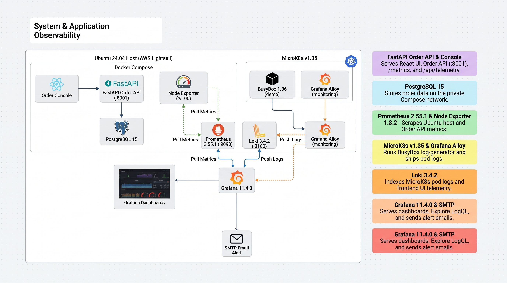

### Deployment and cluster

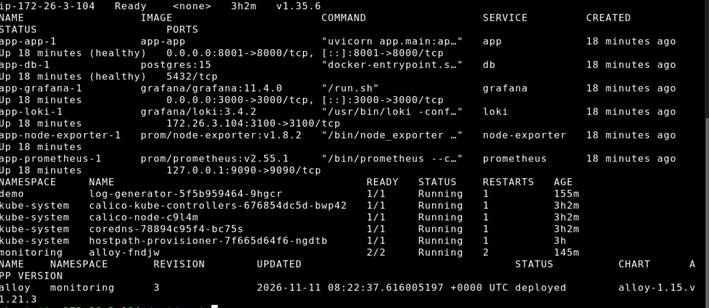

### Metrics dashboard

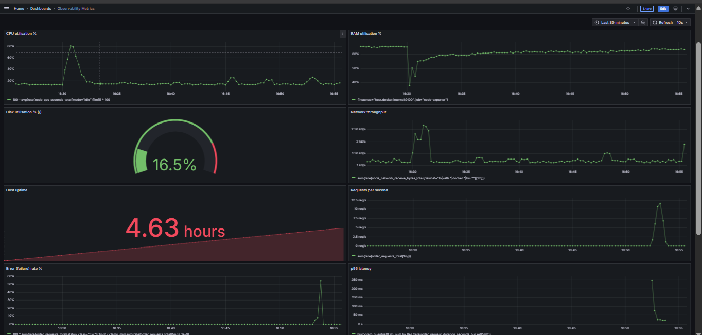

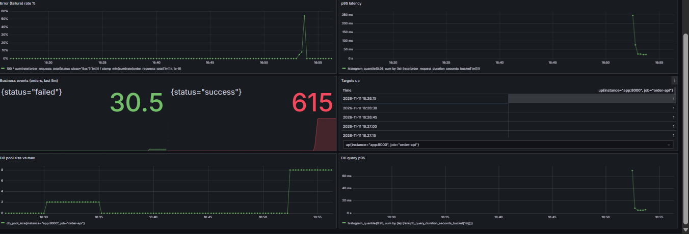

### Kubernetes logs

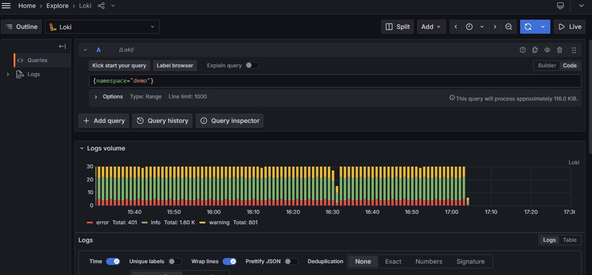

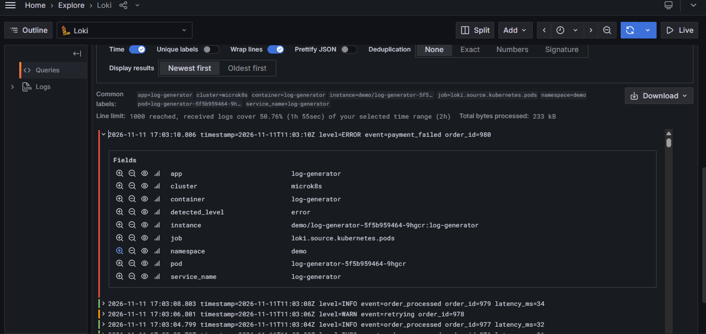

### Alerting

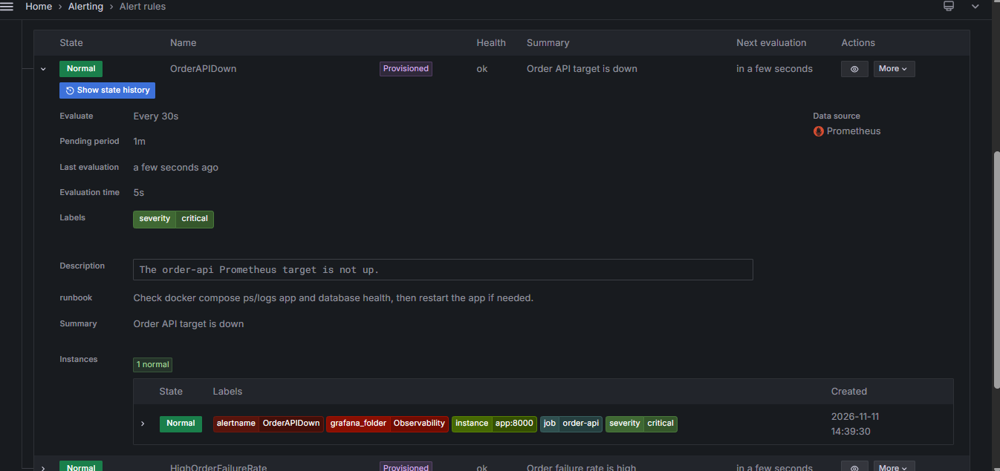

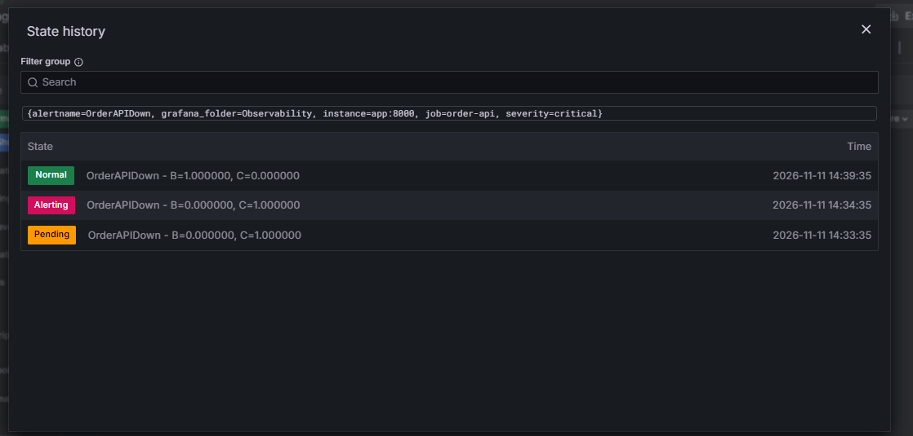

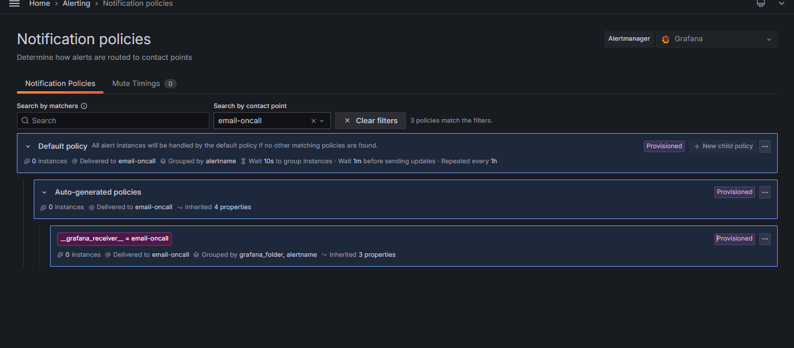

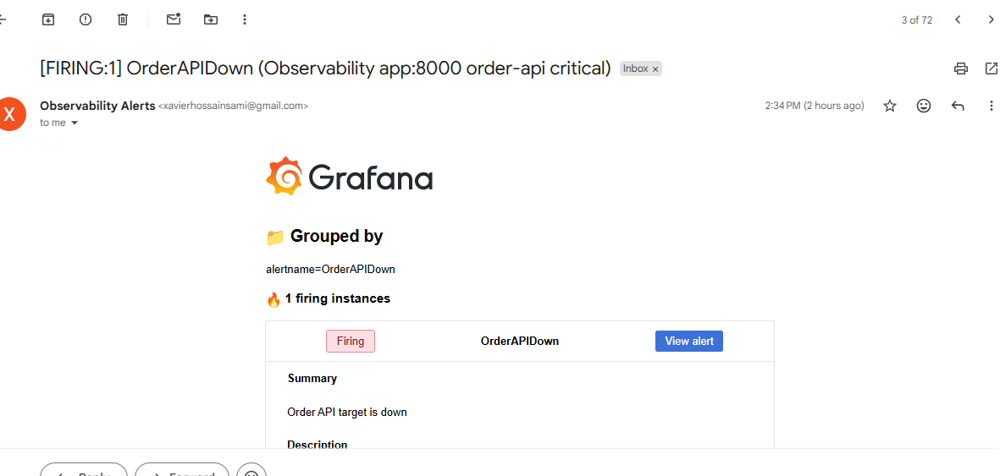

### Persistence

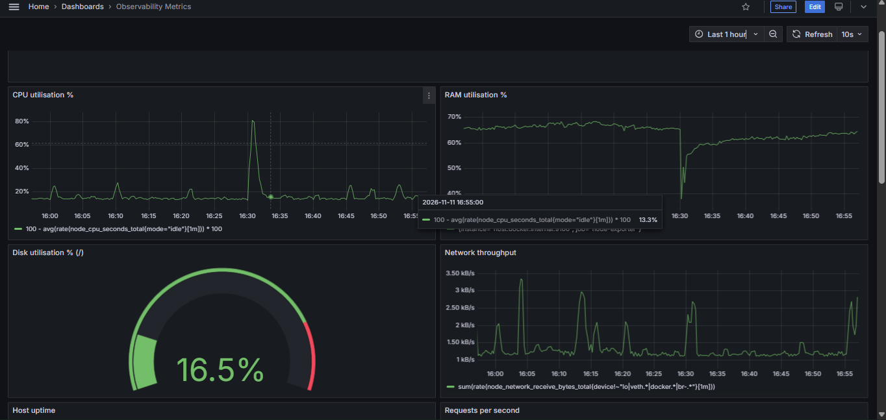

## Evidence still required or worth strengthening

The filenames below are suggested additions; they are **not** currently in this
folder. Do not reference them as if they already exist.

| Missing/weak evidence | What to capture |
|---|---|
| `prometheus-targets.png` | Prometheus Targets page showing both `node-exporter` and `order-api` healthy/UP. |
| `api-metrics.png` | `/metrics` output containing the custom request counter, latency histogram, and business counter; capture before and after generated traffic. |
| `host-crosscheck.txt` | Sanitized output of `scripts/crosscheck.sh` showing Linux `free`, `df`, and `uptime` alongside Prometheus readings. |
| Grafana UI dashboard export | Export the metrics and Kubernetes logs dashboards from Grafana if the evaluator requires an instance export. The source JSON definitions are already tracked in [grafana/dashboards](../grafana/dashboards/). |
| Alloy readiness | Show the Alloy workload healthy in MicroK8s and include a query result that corresponds to a live pod log with namespace/pod/container labels and timestamps. |
| Optional Order Console proof | If presenting the extension, add screenshots for a successful order, controlled failure, frontend metrics, and frontend logs. These are enhancements, not core assignment substitutes. |

`scripts/collect-evidence.sh` writes a timestamped text report when executed
on the target host. It does not generate screenshots. The current committed
evidence directory contains screenshots but no timestamped host cross-check
output file.

## Capture and handling guidance

1. Run the live stack and verify it immediately before taking screenshots.
2. Capture the command output and Grafana/Prometheus views from the same test
   window; do not use mock data or stale screenshots as proof of a live result.
3. Keep timestamps visible where they establish alert delivery or live log
   ingestion.
4. Redact passwords, SMTP credentials, API tokens, private keys, and any
   personal information not intended for the evaluator.
5. Keep the original, unmodified evidence locally. Commit only the reviewed,
   sanitized submission copy.
6. Update this index whenever new artifacts are added or filenames change.

## Related implementation files

- [Metrics dashboard JSON](../grafana/dashboards/observability-metrics.json)
- [Kubernetes logs dashboard JSON](../grafana/dashboards/kubernetes-logs.json)
- [Evidence collection script](../scripts/collect-evidence.sh)
- [Cross-check script](../scripts/crosscheck.sh)
- [Manual handover checklist](../MANUAL_STEPS.md)
